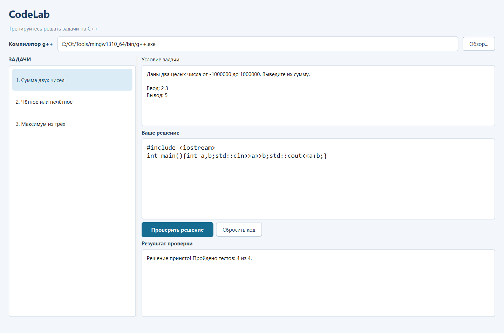

# CodeLab

Настольный тренажёр для решения задач на C++ и проверки ответов на тестах. Проект создан на C++ и Qt Widgets и работает локально: сервер и подключение к интернету для использования не нужны.



## Возможности

- Три задачи: сумма чисел, проверка чётности и поиск максимума.
- Редактор для ввода программы и отображение условия задачи.
- Компиляция решения с помощью установленного `g++` и запуск на наборе тестов.
- Сообщения об ошибке компиляции, неверном ответе и превышении времени.
- Автоматическое сохранение черновика отдельно для каждой задачи и пути к компилятору.

## Что понадобится

- **Qt 6.5 или новее** с модулями Core и Widgets;
- **CMake 3.19 или новее** и компилятор с поддержкой C++17 для сборки приложения;
- **g++** для компиляции решений внутри тренажёра;
- **Qt Creator** для запуска по инструкции ниже.

Приложение проверено с Qt 6.11.2 и MinGW на Windows. На другом компьютере расположение компилятора и комплект Qt могут отличаться.

## Сборка и запуск в Qt Creator

1. Скачайте репозиторий или клонируйте его:

   ```bash
   git clone https://github.com/nanezzio/CodeLab.git
   ```

2. В Qt Creator откройте файл `CMakeLists.txt` через **Файл → Открыть файл или проект**.
3. Выберите установленный комплект Desktop Qt, дождитесь настройки CMake и соберите проект.
4. Запустите приложение. Если поле «Компилятор g++» пустое или путь неверен, нажмите **«Обзор»** и выберите `g++.exe` из установленного комплекта MinGW.

Пример пути для Windows: `C:/Qt/Tools/mingw1310_64/bin/g++.exe`. Укажите путь, соответствующий вашей установке. Если `g++` доступен в переменной `PATH`, можно ввести просто `g++`.

## Как решать задачи

1. Выберите задачу в списке и прочитайте условие.
2. Напишите полную программу в редакторе, используя `std::cin` для чтения входных данных и `std::cout` для вывода ответа.
3. Нажмите **«Проверить решение»**. При ошибке программа покажет сообщение компилятора или данные первого непройденного теста.

Например, решение задачи о сумме двух чисел:

```cpp
#include <iostream>

int main()
{
    int a, b;
    std::cin >> a >> b;
    std::cout << a + b;
    return 0;
}
```

Входные данные каждому тесту передаёт сам тренажёр. Выводите только ответ: дополнительные сообщения вроде `Введите число:` помешают сравнению. Пробелы и переводы строк в начале и конце вывода игнорируются; различия внутри ответа учитываются.

Кнопка **«Сбросить код»** после подтверждения возвращает начальную заготовку для выбранной задачи. Черновики хранятся в настройках текущего пользователя через `QSettings`.

## Как работает проверка

1. Приложение сохраняет код решения во временный файл.
2. Запускает `g++` через `QProcess`. Если компиляция завершилась ошибкой, показывает сообщение компилятора.
3. Последовательно запускает полученную программу для каждого теста, передаёт входные данные и сравнивает вывод с ожидаемым.
4. Показывает результат: количество пройденных тестов или данные первого теста с неверным ответом.

Процессы работают асинхронно, поэтому интерфейс остаётся доступным для отображения состояния проверки. Время ограничено 30 секундами на компиляцию и 3 секундами на каждый тест; лимит суммарного вывода процесса — 64 КБ.

## Структура проекта

```text
CodeLab/
├── CMakeLists.txt       # Сборка и подключение Qt
├── main.cpp             # Точка входа
├── mainwindow.ui        # Форма и оформление интерфейса
├── mainwindow.h         # Объявления окна, задач и тестов
├── mainwindow.cpp       # Задачи, проверка решений и сохранение черновиков
└── docs/images/         # Снимок приложения
```

Условия задач и тестовые данные заданы в `mainwindow.cpp`. Чтобы добавить задачу, нужно дополнить список `tasks`: указать название, условие и пары входных данных с ожидаемыми ответами.

## Ограничения

CodeLab предназначен для локальной учебной работы. Решение запускается с правами текущего пользователя; ограничения времени и вывода не являются безопасной песочницей. Запускайте только код, которому доверяете. Проверка работает с локально установленным `g++` и не предоставляет скрытых тестов.
